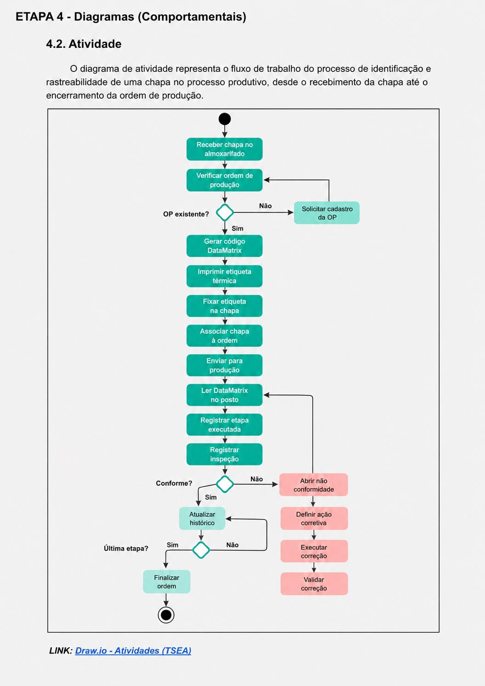

# TraceMetal | Modelagem de Sistemas

**Projeto de portfólio de Matheus Vinícius Santos Silva** · Técnico em Desenvolvimento de Sistemas, SENAI · 2026

O TraceMetal é uma proposta de sistema de rastreabilidade industrial criada para a Situação de Aprendizagem da UC de Modelagem de Sistemas. O estudo usa como contexto a produção de transformadores e reguladores de alta tensão da TSEA.

## Problema e solução proposta

Registros em papel e planilhas isoladas dificultam a consulta ao histórico de uma chapa entre o almoxarifado, a produção e a qualidade. O TraceMetal propõe identificar cada chapa com um código DataMatrix único e vincular suas leituras à ordem de produção, às etapas executadas e às inspeções. Se uma inspeção apontar uma falha, o fluxo registra a não conformidade, atribui uma ação corretiva e encaminha a correção para validação pela equipe de qualidade.

## Entregáveis

| Material | O que demonstra |
| --- | --- |
| [Apresentação](docs/apresentacao.pdf) | Contexto industrial, usuários, fluxo e decisões de modelagem |
| [Relatório técnico](docs/relatorio-tecnico.pdf) | Levantamento de requisitos, 12 regras de negócio, modelos UML, DER e dicionário de dados |
| [Diagramas originais](#diagramas) | Visões do domínio, do comportamento do sistema e da arquitetura proposta |
| [Modelo físico em SQL](banco-de-dados/schema.sql) | Proposta de criação de 13 tabelas relacionais, extraída do relatório |

## Como os requisitos aparecem nos modelos

| Decisão de modelagem | Onde conferir |
| --- | --- |
| Identificar a chapa antes da produção e registrar data, hora, usuário e local em cada leitura (RN-01 a RN-03 e RN-05) | [Atividades](diagramas/atividades.jpg) e [sequência](diagramas/sequencia.jpg) |
| Vincular a não conformidade ao processo produtivo e restringir a validação de correções ao perfil de qualidade (RN-06 a RN-08) | [Casos de uso](diagramas/casos-de-uso.jpg) e [comunicação](diagramas/comunicacao.jpg) |
| Relacionar ordens, chapas, inspeções e ações corretivas para manter o histórico consultável | [Classes](diagramas/classes.jpg), [DER](diagramas/der.jpg) e [dicionário de dados](docs/relatorio-tecnico.pdf#page=23) |

## Diagramas

| Visão | Diagramas |
| --- | --- |
| Estrutura | [Classes](diagramas/classes.jpg) · [Objetos](diagramas/objetos.jpg) · [Componentes](diagramas/componentes.jpg) · [Implantação](diagramas/implantacao.jpg) · [Pacotes](diagramas/pacotes.jpg) |
| Comportamento | [Casos de uso](diagramas/casos-de-uso.jpg) · [Atividades](diagramas/atividades.jpg) · [Sequência](diagramas/sequencia.jpg) · [Comunicação](diagramas/comunicacao.jpg) |
| Dados | [Diagrama entidade-relacionamento](diagramas/der.jpg) |

A entrega acadêmica documenta a modelagem e a proposta inicial de banco de dados para uma implementação futura. A auditoria de cada leitura e as condições de encerramento da ordem são requisitos da solução. O script SQL registra a estrutura inicial das tabelas.
